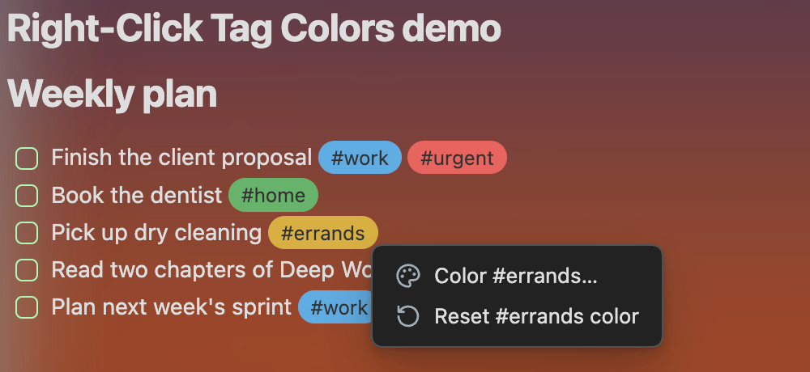
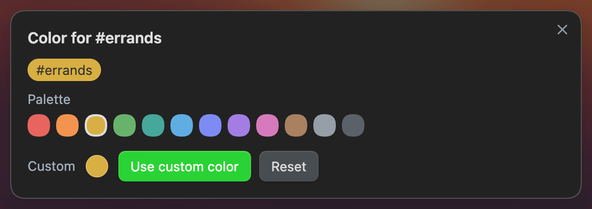
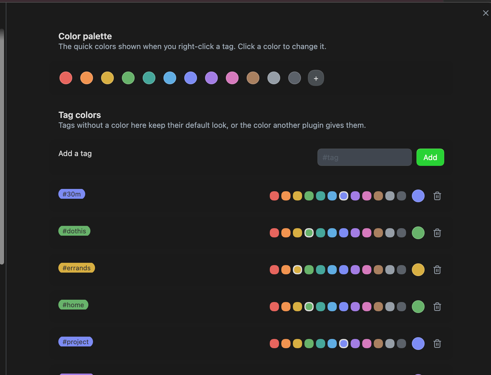

# Right-Click Tag Colors

Color any tag in Obsidian with a right-click. No settings page, no CSS snippets: right-click the tag where you see it, pick a color, done.

## Right-click works everywhere tags show up

- **Notes you are editing** (Live Preview and source mode). "Color #tag…" is added to Obsidian's own right-click menu.
- **Reading view.**
- **Tasks plugin query results** (`tasks` code blocks).
- **Dataview and DataviewJS output.**
- **Tag pills in Properties and Bases.**

Nested tags like `#people/anna` work too, and each one gets its own color.

## Pick a palette color, or any color

The color window shows your palette for one-click picks. If no palette color fits, use the custom picker to choose any color. **Reset** gives the tag back its default look. Text on a colored tag automatically turns dark or light, so it stays readable.

## Edit everything in settings

- **Color palette:** change, add or remove the quick colors.
- **Tag colors:** every colored tag in one list. Recolor it from the palette or with the color picker, or remove its color. You can also add a tag by name (press Enter or click **Add**). A search box appears once the list grows.

## Works with Colored Tags

Using an automatic tag-coloring plugin such as [Colored Tags](https://github.com/pfrankov/obsidian-colored-tags)? Keep it. Tags you color with this plugin use your color, and every other tag keeps its automatic color.

## Installation

**From Obsidian:** Settings → Community plugins → Browse → search for "Right-Click Tag Colors" → Install → Enable.

**Manually:** download `main.js`, `manifest.json` and `styles.css` from the [latest release](https://github.com/toto1384/obsidian-right-click-tag-colors/releases/latest), put them in `<your vault>/.obsidian/plugins/right-click-tag-colors/`, then enable the plugin in Settings → Community plugins.

## Phone and tablet

The plugin works on mobile. Long-press a tag instead of right-clicking.

## License

[MIT](LICENSE)
